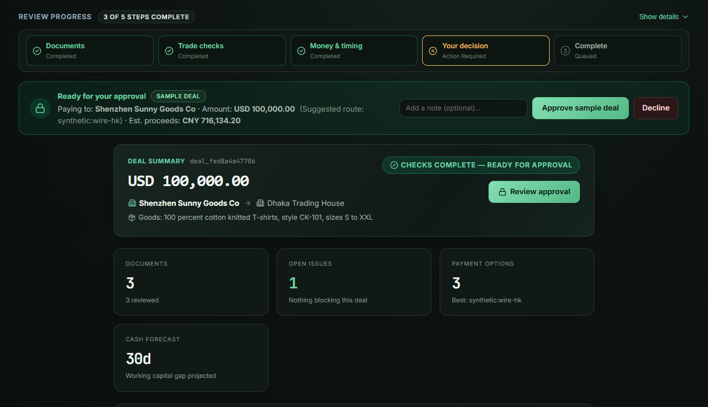
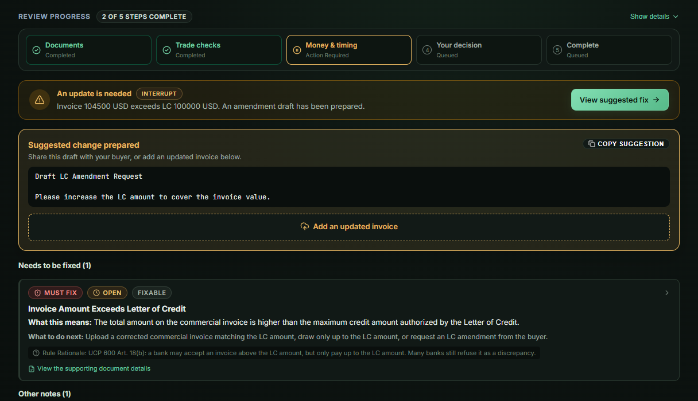
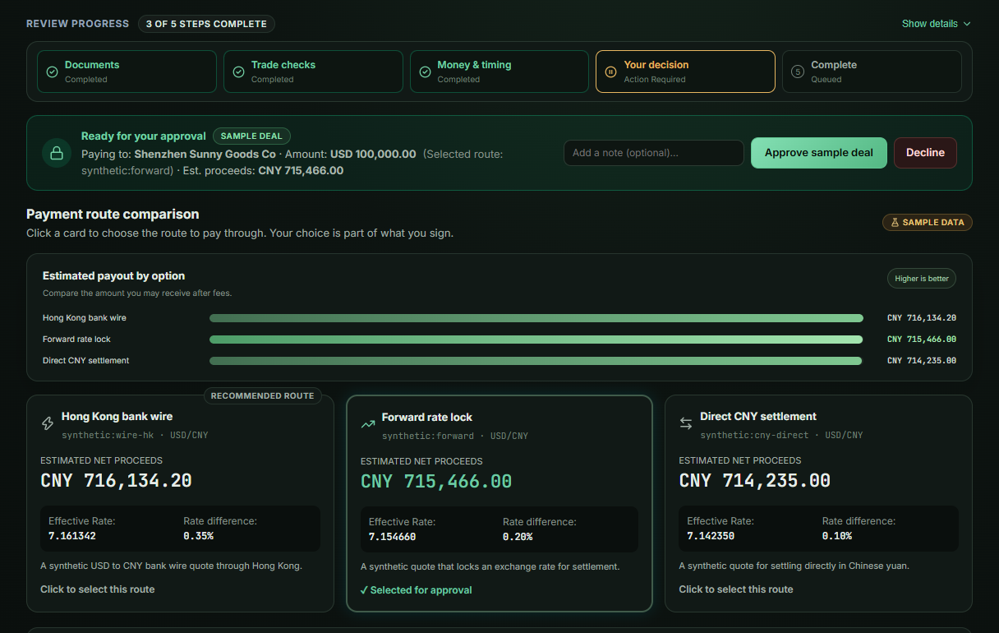
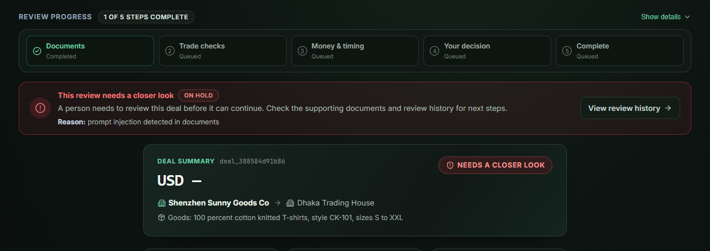
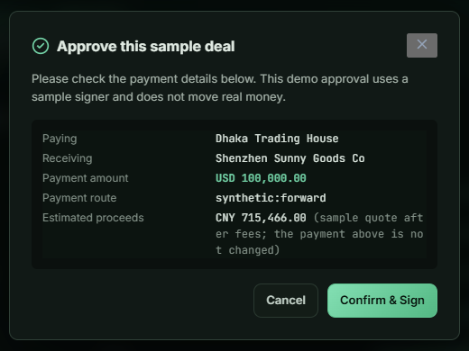
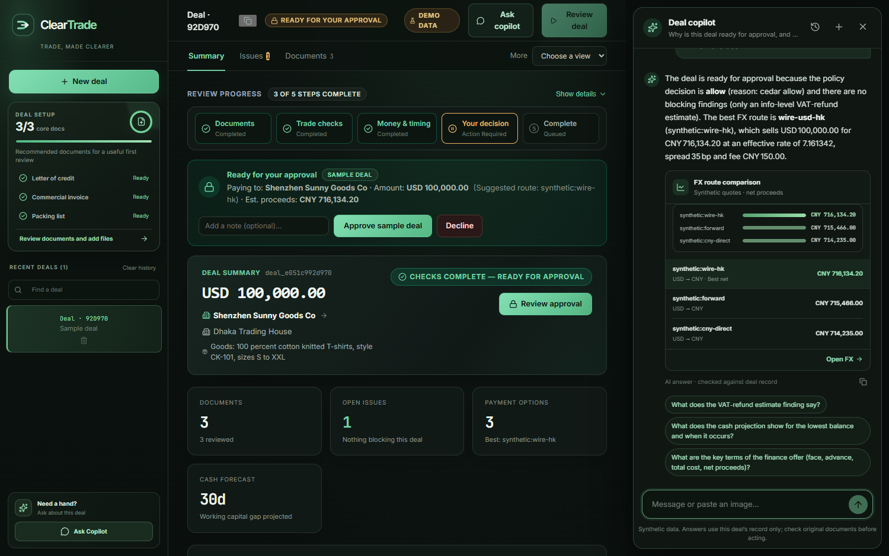

# ClearTrade

**A safe AI pre-flight for cross-border letter-of-credit export deals.**

ClearTrade reads the trade documents for one export deal, finds the problems a
bank would reject it for, compares payment routes, forecasts cash flow, and then
**stops for a person to approve** before any (sandbox) payout. Language models
read and explain text. Plain, tested code routes, calculates and acts. A human
has the last word.

Built by team **Tech_Hoodie$** for the 2026 Shenzhen International FinTech
Competition (FinTechathon), International Track, Topic E: SME Finance Copilot.

> ⚠️ **All data in this repository is synthetic.** There are no real customers,
> payments or customs filings, and payouts are a sandbox simulation. The console
> shows a permanent SYNTHETIC DATA badge.



---

## Contents

- [The problem](#the-problem)
- [What ClearTrade does](#what-cleartrade-does)
- [Design thesis](#design-thesis)
- [Architecture](#architecture)
- [The review workflow](#the-review-workflow)
- [Security model](#security-model)
- [Quick start](#quick-start)
- [Using the console](#using-the-console)
- [Configuration](#configuration)
- [Development](#development)
- [Testing and evaluation](#testing-and-evaluation)
- [Repository layout](#repository-layout)
- [Documentation map](#documentation-map)
- [Known limitations](#known-limitations)

---

## The problem

Under a documentary letter of credit (LC), a small exporter can lose a whole
shipment to a single discrepancy: a shipment date after the allowed date, or an
invoice above the LC amount. Export tax-refund rules are unclear to them, the
FX route changes what they actually receive, and banks catch document problems
late and by hand.

## What ClearTrade does

The demo corridor is a Shenzhen seller shipping to a buyer in Dhaka, Bangladesh
under a USD 100,000 LC. For one deal, ClearTrade:

1. **Reads the documents** (LC, commercial invoice, packing list; PDF, PNG or
   JPG). Every extracted field carries a confidence and a verbatim quote from
   the source; quotes that are not real text from the file are dropped.
2. **Screens for hidden instructions**: instruction-like phrases (English and
   Chinese), beneficiary-change language and white-on-white text.
3. **Checks the documents deterministically** against UCP 600 rules (amount,
   expiry, latest shipment, 21-day presentation, goods, quantity, beneficiary),
   screens against a synthetic sanctions list and estimates the export VAT refund.
4. **Explains each finding** in plain words and drafts an amendment request for
   fixable problems.
5. **Compares three payment routes** by net CNY proceeds and **forecasts 90 days
   of cash flow**.
6. **Computes a synthetic trade-finance offer**.
7. **Asks a person to approve or decline** over exactly what was shown, using an
   Ed25519 signature.
8. **Only after a verified approval**, runs a sandbox payout once, and anchors
   the head of a hash-chained audit trail (a mock anchor in this build).

A read-only **deal copilot** answers questions about one deal. An optional
**vision model** reads scanned and photographed documents.

| Findings with evidence and amendment draft | Approver picks the payment route |
|---|---|
|  |  |

## Design thesis

*Workflow, not orchestrator.* Models are untrusted workers that read and write
text. They never decide what happens next, never compute money, and never act.
Everything with consequences is ordinary code, and the last word belongs to a
person.

The rules below are non-negotiable and enforced in code (see
[BUILD_PLAN.md §0](BUILD_PLAN.md)):

1. Graph routing is plain Python functions, never an LLM.
2. Models never compute money. All tax, FX, cash-flow and credit maths lives in
   `backend/app/calc/` (integer minor units, 100% branch coverage enforced).
3. Untrusted text (documents, chat) is quarantined and wrapped in `<untrusted>`
   tags in prompts.
4. Tools declare node allowlists; the registry refuses and audits anything else.
5. The payout and anchor tools are only called by the deterministic `execute`
   node, with a verified approval.
6. Fail closed: when evidence is missing or uncertain, escalate to a person.
7. Audit events are written by hooks, never by node code.
8. Every model call goes through the self-hosted LiteLLM proxy; no provider SDKs
   in the backend and no provider keys in the backend.
9. Money is integers. Floats never touch amounts.
10. Synthetic data only, labelled in the UI.

## Architecture

```
  Browser ──► Web console (React 18 + TypeScript + Vite, nginx, SSE-safe proxy)
                    │  REST + Server-Sent Events
                    ▼
  FastAPI backend (Python 3.12, uv, Pydantic v2)
   ├─ graph/     LangGraph state machine, 16 nodes, pure-Python routers
   ├─ harness/   hooks · budgets · tool registry · LLM client · policy · prompts/skills
   ├─ calc/      pure integer money maths (VAT refund, FX, finance, cash flow)
   ├─ rules/     UCP 600 check battery + curated rule pack
   ├─ audit/     hash chain + anchor interface
   └─ security/  approval signing · content-addressed document store
        │                 │                    │
        ▼                 ▼                    ▼
   LiteLLM proxy    PostgreSQL 18        Valkey (Redis)
   reasoner · fast  + pgvector           payout idempotency
   · vision (opt.)  snapshots, audit
   holds the keys   chain, checkpoints
        │            (row-level security)
        ▼
   Model providers (free OpenRouter models in the demo)
```

| Layer | Responsibility |
|---|---|
| Web console (`web/`) | Deal list, summary, findings, documents, FX routes, cash forecast, review history, approval bar and dialog, copilot, upload |
| API (`backend/app/api/`) | Deal lifecycle, upload gate, run/resume, SSE stream, audit read, copilot, demo seeding |
| Workflow (`graph/`) | LangGraph nodes and deterministic routers |
| Harness (`harness/`) | Budget, audit hooks and state invariants around every node; tool registry; LLM client; policy engine |
| Deterministic core | `calc/`, `rules/`, `security/`, `audit/` |
| Model gateway (`litellm/`) | The only path to any model; holds provider keys; the backend gets a spend-capped virtual key |

Stack: Python 3.12 with a hash-locked `uv.lock`, FastAPI, LangGraph, LiteLLM
(pinned to v1.105.0), Cedar (`cedarpy`) policy engine, PyMuPDF, PostgreSQL 18 +
pgvector, Valkey, React 18, TanStack Query, Docker Compose. Postgres, Valkey,
LiteLLM and cloudflared images are pinned by digest.

## The review workflow

```
START → intake → extract_doc* → injection_screen → plan
plan → compliance ┐
plan → fx         ├→ verify → credit_offer → policy_check → human_approval
plan → cashflow   ┘     │                                       │
                        ├→ resolve_exception → await_corrected_doc → extract_doc*
                        └→ escalate                       signed → execute → report
                                                        declined → report
```

`extract_doc*` fans out one extraction per document. `compliance`, `fx` and
`cashflow` run in parallel and join at `verify`. Every other uncertain path
routes to `escalate`, which records a plain-language reason for a person.

Highlights of the core algorithms (full detail in
[docs/TECHNICAL_DOCUMENT.md](docs/TECHNICAL_DOCUMENT.md)):

- **Grounded extraction.** Each field has a value, a confidence and a source
  snippet that must be a verbatim substring of the parsed document.
- **Verification.** `verify` re-derives every finding from the source documents;
  a finding the deterministic battery no longer reproduces is closed, and the
  judgement call is made with degraded fallback models disallowed.
- **Money maths.** `Money(minor: int, currency)`, half-up rounding stated, and a
  currency mismatch raises. The VAT refund is capped at input VAT.
- **Policy.** Five payout rules evaluated by Cedar with a deterministic fallback;
  any disagreement between the two denies.
- **Approval.** The approver signs `SHA-256(canonical_json(approval_render))`,
  which includes findings, waivers, injection flags, FX options, the chosen FX
  route, the finance offer, payee, applicant, amount and policy result. Any
  change after signing invalidates the approval. A 300-second replay window
  applies, and the signature is verified again at execution.
- **Execution.** A Redis `SET NX` lock on `payout:{deal_id}:{deal_hash}` lets a
  signed approval pay out once.
- **Audit chain.** `hash = SHA-256(prev_hash ‖ canonical_json(event))` per
  tenant; the Postgres table is append-only for the app role and protected by
  row-level security. The console shows "Review history verified".

## Security model

| Control | How |
|---|---|
| Separation of duties | Models read and write text; code routes, computes and acts; a person authorises. No model is given tool definitions. |
| Untrusted input | Magic-byte and size checks (10 MB), content-addressed read-only storage, local parsing, screening, `<untrusted>` quarantine in every prompt |
| Prompt injection | Deterministic rules + a classifier; image-only documents cannot be screened and are held for a person |
| Money movement | Fresh Ed25519 signature over the exact rendered deal, checked twice, single-use, bound to the chosen FX route |
| Tool access | Per-node allowlists enforced and audited by the registry; payout and anchor tools are `act` tools, not LLM-callable |
| Fail closed | Missing evidence, invalid output, low confidence, policy deny or budget breach all route to `escalate` |
| Budgets | Per-deal step, token and cost limits; a breach escalates |
| Secrets | Provider keys live only in the LiteLLM proxy; the backend uses a spend-capped virtual key restricted to named aliases |
| Copilot guard | Tool-less call; instruction-like questions are declined; an answer quoting a number not in the deal record fails closed |



**Honest boundaries.** The committed Ed25519 key is a public demo fixture, not a
credential. In the demo, approval is signed by a server-side demo signer
(`POST /deals/{id}/sign_demo`), which is on unless the backend runs with
`ENV=dev` (the variable settings reads is `ENV`, default `demo`; the
`CLEARTRADE_ENV` shown in `.env.example` is not read). The audit anchor is a
mock, the API has no authentication, and the WeChat adapter is a disabled-by-default
structural scaffold with demo-grade SOTER checks. Do not treat any of this as
production authentication. The full risk register is in
[docs/SECURITY_SELF_ASSESSMENT.md](docs/SECURITY_SELF_ASSESSMENT.md).

## Quick start

Prerequisites: Docker Desktop (with WSL integration enabled on WSL2), `make`,
and [uv](https://docs.astral.sh/uv/). Node.js is needed only for web development.

```bash
cp .env.example .env     # choose LLM_PROVIDER, model names and *_API_KEYS (see Configuration)
make up                  # postgres + pgvector, valkey, litellm, backend, web
make llm-key             # create the backend's spend-capped LiteLLM key and save it to .env
docker compose up -d --force-recreate backend    # load the new key
```

| Service | URL |
|---|---|
| Web console | http://localhost:5173 |
| API health | http://localhost:8000/health |
| LiteLLM proxy | http://localhost:4000 |

Open the console and use one of the four one-click demo scenarios, then follow
[WALKTHROUGH.md](WALKTHROUGH.md) for the same flow with real commands and
expected output.

`make llm-key` needs the proxy running and `LITELLM_MASTER_KEY` in `.env`. It
creates a key limited to the `reasoner`, `fast` and `vision` aliases with a
default USD 10 / 30-day cap, writes it to `LITELLM_VIRTUAL_KEY`, and never prints
the secret. Raise the cap with
`uv run --directory backend python ../scripts/generate_litellm_key.py --max-budget 25`.

Reset to a clean demo at any time with `make reset-demo`. Stop the stack with
`make down`.

### Without Docker (offline tests and evaluation)

The unit, graph, API, security, channels and seed suites run entirely offline
with scripted models, in-memory stores and the committed seed PDFs:

```bash
make install   # uv sync --frozen + npm install
make gates     # lint + mypy strict + tests + 100% branch coverage on calc/
make eval      # metrics table (offline, deterministic)
```

### Temporary showcase URL

`make tunnel` starts the stack with a Cloudflare Quick Tunnel and prints a
temporary `https://…trycloudflare.com` URL (`make tunnel-dev` for Vite hot
reload). The URL changes when the tunnel restarts. Anyone with the URL can reach
the demo, and the demo has no authentication, so use it for controlled
showcases only and keep real data and credentials out. Stop with
`docker compose --profile tunnel down` (include both compose files for the dev
stack).

## Using the console



1. **Pick a scenario or upload documents.** The workspace offers four one-click
   scenarios: `clean`, `discrepancy`, `mismatch` and `injection`. You can also
   create a deal and upload an LC, invoice and packing list.
2. **Watch the run.** Each graph node streams over SSE as it executes, with a
   five-step progress bar.
3. **Review.** Summary, Issues (findings linked to evidence), Documents (with
   confidence), and a More menu with FX routes, Cash forecast and Review history.
   Documents read from an image are marked **Unverified**.
4. **Fix or escalate.** A fixable discrepancy drafts an amendment request and
   waits for a corrected document. An unfixable one (for example a beneficiary
   mismatch) fails closed and is handed to a person.
5. **Approve or decline.** Choose the payment route, check the estimated CNY
   proceeds, and confirm. Approving signs exactly what you saw and runs the
   sandbox payout once. Declining records an optional note and ends the deal in a
   clear *declined, no payment made* state.
6. **Ask the copilot.** It answers from the deal record only and explains numbers
   without computing them.
7. **Check the audit trail.** The hash chain is verified in the console and can
   be exported; the sandbox receipt records the payout. No real money moves.



### API at a glance

| Method and path | Purpose |
|---|---|
| `GET /health` | Liveness and environment |
| `POST /deals` · `POST /deals/demo-seed/{scenario}` | Create a deal, or seed one (`clean`, `discrepancy`, `mismatch`, `injection`) |
| `POST /deals/{id}/documents` · `DELETE …/{doc_id}` | Upload (PDF, JPEG, PNG; 10 MB) or remove a document |
| `POST /deals/{id}/run` | Start the review (409 if a run is active or awaiting a decision) |
| `GET /deals/{id}/stream` | SSE: `node_started`, `node_finished`, `interrupt`, `done`, `error`, `ping` |
| `POST /deals/{id}/resume` | `approve` (signed, optional `fx_route`), `reject` (with note) or `corrected_document` |
| `POST /deals/{id}/sign_demo` | Demo only: sign the current render with the committed demo key |
| `GET /deals/{id}/audit` | Audit events and chain verification result |
| `POST /deals/{id}/copilot` | Read-only Q&A about one deal |

Every response carries `synthetic_data: true`. The full table is in
[docs/TECHNICAL_DOCUMENT.md §7](docs/TECHNICAL_DOCUMENT.md).

## Configuration

Copy `.env.example` to `.env` and restrict its permissions. `.env` is ignored by
Git; never commit credentials.

| Variable | Purpose |
|---|---|
| `LLM_PROVIDER` | `anthropic`, `openai`, `google`, `ollama`, `deepseek` or `dashscope` |
| `LLM_REASONER_MODEL` / `LLM_FAST_MODEL` | LiteLLM model strings with provider prefix. Unset uses provider defaults (Anthropic: Claude Sonnet 5.5 and Haiku 5.5) |
| `LLM_VISION_MODEL` | Optional. Enables the `vision` alias for images and scanned PDFs |
| `<PROVIDER>_API_KEYS` | Comma-separated key rotation pool. The proxy round-robins one deployment per key and benches keys returning 429/503 |
| `LITELLM_MASTER_KEY` | Proxy admin key (never used by the backend) |
| `LITELLM_VIRTUAL_KEY` | Backend's spend-capped key, created by `make llm-key` |
| `ENV` | `demo` (default) enables the demo signer; `dev` disables it |

`harness/litellm_render.py` renders the proxy config at start-up using only
`os.environ/` references, never secrets. The backend waits 90 s for text calls
and 180 s for vision calls.

## Development

uv is the only supported Python runner (never bare `python` or `pip`; the
hash-locked `uv.lock` only protects runs inside uv). The Makefile wraps it.
**`make help` lists every target.**

| Command | What it does |
|---|---|
| `make install` | Backend deps from the hash-locked `uv.lock` + web deps |
| `make gates` | Everything CI checks: lint + mypy strict + tests + 100% calc coverage |
| `make lint` / `make format` | ruff check and format check / auto-format |
| `make typecheck` / `make test` / `make coverage` | The individual gates |
| `make test-integration` | Postgres-backed tests (needs `TEST_DATABASE_URL` or `make up`) |
| `make eval` / `make eval-live` | Seed-suite metrics, offline / through the LiteLLM proxy |
| `make redteam` | promptfoo red-team suite (needs proxy + `LITELLM_VIRTUAL_KEY`) |
| `make seeds` / `make seeds-verify` | Regenerate the synthetic PDFs / prove they are byte-identical |
| `make render-config` / `make proxy` | Render the LiteLLM config / run the proxy via uvx |
| `make up` / `make down` | Production-style Docker stack lifecycle |
| `make up-dev` / `make down-dev` | Docker stack with Vite hot reload for frontend edits |
| `make logs` / `make logs-dev` / `make logs-web` / `make status-dev` | Follow logs and check service status |
| `make web-dev` / `make web-build` | Vite dev server / type-check and production build |
| `make reset-demo` | Wipe containers, volumes, uploads and rendered config |

Quality gates before claiming anything works:

```bash
cd backend && uv run pytest tests -q && uv run ruff check app tests && uv run mypy
```

When a requirement is unclear, add a `# DECISION:` comment, record it in
[DECISIONS.md](DECISIONS.md), and move on. Never weaken a §0 rule to make a test
pass. Conventions are in [AGENTS.md](AGENTS.md).

## Testing and evaluation

| Layer | Covers | Where |
|---|---|---|
| Unit | Calculators (property-based + hand-checked), rule checks, approval signing, audit chain, loaders, harness | `backend/tests/unit/` |
| Graph acceptance | Compiled-graph paths: clean to approval, fixable discrepancy, unfixable escalation, injection, policy deny, rejected approval, FX route choice, vision read | `backend/tests/graph/` |
| API | httpx ASGI tests of routes, upload gate, resume, signing, run guard | `backend/tests/api/` |
| Integration | Postgres row-level security and append-only audit (env-gated) | `backend/tests/integration/` |
| Eval | Metrics runner over the seed suite | `backend/tests/eval/` |
| Red team | promptfoo injection cases with clean controls | `evals/promptfoo/` |

Last recorded gate run (2026-10-20, see [PROGRESS.md](PROGRESS.md)): ruff clean,
mypy strict clean, 411 backend tests passing with 12 env-gated skips, `calc/` at
100.00% branch coverage, web type-check, unit tests and build clean. One
pre-existing `ruff format --check` warning remains in `tests/graph/test_graph.py`.

Offline evaluation over the seed suite with scripted extraction: discrepancy
recall 1.0, false alarms 0.0, workflow completion 1.0, calculation exactness 1.0,
unauthorised actions 0. These use fake extraction, so they measure the
deterministic core rather than live-model accuracy.

Seed data: 10 synthetic deals, 8 poisoned PDFs and four synthetic end-to-end LC
lifecycle deals, all generated deterministically and checked against committed
checksums.

## Repository layout

```
backend/app/          FastAPI app: api/, graph/ (nodes, routers, build), harness/
                      (llm, tool registry, hooks, budget, policy), calc/ (pure
                      integer money maths), rules/ (checks + bitemporal store),
                      audit/ (hash chain + anchoring), db/, security/,
                      channels/wechat/
backend/tests/        unit/ · graph/ · integration/ · api/ · eval/
backend/seed/         synthetic deals, poisoned docs, lifecycle deals, rule pack,
                      deterministic PDF generator (byte-identical output)
backend/skills/       9 skills: SKILL.md + curated rules.yaml + tools.txt + examples
backend/prompts/      16 versioned per-node prompts
web/                  React review console (Vite + TypeScript + React Query)
miniprogram/          WeChat Mini Program (pages pending; adapter mounts only when enabled)
litellm/              LiteLLM proxy configuration
evals/promptfoo/      red-team suite
docs/                 technical document, security self-assessment, images
scripts/              LiteLLM key generation, proxy start, tunnel helper
```

## Documentation map

| Document | What it covers |
|---|---|
| [docs/TECHNICAL_DOCUMENT.md](docs/TECHNICAL_DOCUMENT.md) | Submission technical document: architecture, workflow graph, core algorithms, security design, API, limits and roadmap |
| [docs/SECURITY_SELF_ASSESSMENT.md](docs/SECURITY_SELF_ASSESSMENT.md) | Permission tiers, OWASP LLM Top 10 mapping, risk register, corrections to earlier statements |
| [WALKTHROUGH.md](WALKTHROUGH.md) | One deal end to end plus the three failure paths, with real commands and expected output |
| [REPRODUCIBILITY.md](REPRODUCIBILITY.md) | Exact pins, how to reproduce test and eval results, byte-identical seed data |
| [BUILD_PLAN.md](BUILD_PLAN.md) | Architecture source of truth: non-negotiable rules, milestones, graph wiring, tool registry |
| [PROGRESS.md](PROGRESS.md) | Milestone status, measured numbers, known gaps |
| [DECISIONS.md](DECISIONS.md) | Every decision made under ambiguity, with the reason |
| [AGENTS.md](AGENTS.md) | Conventions and gates for anyone touching the code |
| [web/README.md](web/README.md) | The review console |

## Known limitations

This is a competition prototype. Stated plainly:

1. No authentication or authorisation on the API; one synthetic tenant.
2. Approval uses a server-side demo signer with a committed public key. Real
   WebAuthn or WeChat SOTER signing is not implemented.
3. The audit anchor is a mock; no blockchain is involved in this build.
4. Image and scanned documents always go to a person for review; there is no
   "confirm these values" step yet.
5. The Bangladesh import-tax calculator exists and is unit-tested but is not
   part of the deal review.
6. The rule pack (33 rules), sanctions list, FX quotes and finance terms are
   demonstration data; no rule is marked verified against a primary source.
7. Free models are slow (20 to 37 s per text document, up to several minutes for
   an image deal), and the proxy's 30 s text timeout can cut a long call.
8. Single process: SSE queues and copilot counters are in memory.
9. Injection screening is defence in depth, not a guarantee. The real controls
   are deterministic checks, grounded quotes and human approval.

Roadmap, in priority order: real approver authentication and client-side
signing; a human confirmation step for image documents; wiring the import-tax
calculator with a verified rule pack; a real anchor (or removing the claim); API
authentication, rate limiting and CORS policy; a dependency scan in CI.
